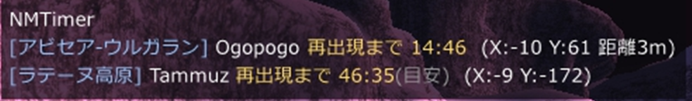

# NMTimer (v0.4.0)

**FFXI（Windower 4 用） NM の再出現タイマー**

メイジャンの試練（エンピリアン武器の素材づくり）に出てくる NM が倒された時刻と場所を覚えて、「次に出られるまで」を画面に出すアドオンです。先に誰かに倒されて間に合わなかった NM も、倒された時刻と場所が分かれば次を狙えます。

> ⚠️ **同梱データの時間は wiki の記述で、ゲーム内で確かめたものは一部だけです。** 目安のものは表示に「(目安)」と出ます。使いながら実測で直してください。
>
> ゲーム内で動きを確かめたもの（2026-10-16、日本語クライアント）: 倒れた NM の検知と記録、HUD、座標と距離、自分で足した NM、PH の指定・記録・再湧きの実測・削除、抽選型（Golden Bat）、アビセアン（Tammuz）、Ogopogo。
> 確かめていないもの: ほかの同梱の NM の名前の一致、ヴァナ・ディールの異変の NM（イベント期間外）、音と前もっての知らせ、時間型の再出現の実測。

---

## 🌟 できること

* **倒された NM を自動で記録します。** 自分の画面に映る範囲の討伐が対象です（誰が倒しても記録されます）。ゲームのサーバーへは何も送りません。受け取るだけです。
* **次に出られるまでの残り時間を HUD に出します。** 複数の NM を同時に並べられます。ドラッグで動かせます。
* **前もって知らせます。** 出られる何分前かはコマンドで変えられます（初期値は 5 分前）。音とチャットログの両方に出せます。
* **場所を覚えます。** 倒された座標と、今の自分からの距離を表示します。
* **時間が分からない NM でも使えます。** 「再出現の時間は不明です」と知らせて、あなたが `//nmt time` で分数を決められます。
* **実測で時間を確かめます。** 倒した場所のエリアに居続けて、同じ名前の敵が現れたら、何分で出たかを覚えて一覧に出します。
* **PH の再湧き時間も、自動で測ります。** PH を倒した時刻と、その敵の ID を覚えます。同じ ID の敵が再び現れたら、かかった時間が実測になります。実測は ID とエリアを付けて 10 回分まで覚えます。次に PH を倒したときは、その ID の実測の中央値（なければそのエリアの実測の中央値）で数えて、「PH再湧きまで 4:52 (実測)」のように HUD に出ます。再湧き時間は PH ごと・エリアごとに違うことがあるので、最初に 1 回測れた時点で、そのエリアの時間として使い始めます。
* **PH は何体でも登録できます。** ID の違う 2 体のどちらかが抽選の対象、という NM にも対応します。PH ではない敵を数えてしまったときは、`//nmt ph del` で外せます（記録も消えます）。
* **見ていなかった討伐も記録できます。** シャウトなどで知ったら `//nmt tod` で「○分前に倒された」と入れます。
* **終わった NM は消せます。** `//nmt off` で追跡をやめると、HUD から消えます。
* **自分の NM を足せます。** ターゲットした敵を `//nmt add` で追加できます。

## 📋 同梱している NM（73 体）

エンピリアン武器のメイジャンの試練に出てくる NM のうち、エリアが決まっているもの（武器・アビセアン・ウルガランの NM）と、イベント「ヴァナ・ディールの異変を調査せよ」の NM です。**Brulo・Maere・トリガーアイテムで湧かせる NM（Ironclad など）・デュナミスの NM は入れていません**（自分で足せます）。

| 種類 | NM | 数える時間 |
|---|---|---|
| 抽選型（PH を倒すと NM が出る・56 体） | 各武器の最初の段階に出る NM ほか。Tumbling Truffle・Helldiver・Orctrap・Intulo・Ramponneau・Keeper of Halidom・Golden Bat・Nocuous Weapon・Black Triple Stars・Serra・Bugbear Strongman・La Velue・Hovering Hotpot・Serpopard Ishtar・Tottering Toby・Drooling Daisy・Gargantua・Megalobugard・Ratatoskr・Bloodpool Vorax・Slippery Sucker・Seww the Squidlimbed・Ankabut・Okyupete・Panzer Percival・Ge'Dha Evileye・Bashe・Hoo Mjuu the Torrent・Daggerclaw Dracos・Namtar・Ah Puch・Donggu・Slendlix Spindlethumb・Herbage Hunter・Kirata・Zi'Ghi Boneeater・Lumbering Lambert・Deadly Dodo・Vuu Puqu the Beguiler・Buburimboo・Zo'Khu Blackcloud・Stray Mary・Hawkeyed Dnatbat・Dune Widow・Teporingo・Valkurm Emperor・Hyakume・Gloomanita・Mischievous Micholas・Cactuar Cantautor・Be'Hya Hundredwall・Jolly Green・Trembler Tabitha・Desmodont・Moo Ouzi the Swiftblade・Ni'Zho Bladebender | NM を倒してから、抽選が始まるまでの時間（0〜90 分。「(目安)」付きは wiki の記述があいまいなもの） |
| 時間型（17 体） | アビセアン: Capricornus・Yacumama・Lamprey Lord・Shoggoth・Jyeshtha・Farruca Fly・Skuld・Urd・Erebus・Feuerunke・Chesma・Tammuz（撃破後 約 60 分、各エリアに 1 体） / Ogopogo（アビセア-ウルガラン、15〜20 分） / Barbastelle（龍王ランペールの墓、15〜20 分） / 異変の Kirin（ル・オンの庭）・Fafnir（ボヤーダ樹）・Alexander（アルザダール海底遺跡群。出現場所はランダム）（討伐から 55 分） | 倒してから再出現まで |

* 抽選型は「PH を倒しても、一定時間は NM が出ない」仕組みです。その時間が終わるまでを数えます。PH の再湧き間隔が分かっているもの（Ramponneau・Keeper of Halidom・Serra など）は、PH が再び湧くまでの時間も数えます。
* **メイジャンの武器の最初の段階の NM は、2013 年 11 月 5 日の更新で抽選までの時間が大きく短縮されました。** wiki に具体的な分数が無いものは、「約○分で出た」という報告を目安にしています。Deadly Dodo は分数が分からないので、時間は空のままです（`//nmt time` で決められます）。
* イベントの NM は、倒すと宝箱が出ます。再出現は「宝箱の消失から 45 分後」と言われていて、討伐から数えると 55 分です。公式の案内は「約 45 分後」で、実測とずれがあります。イベントの期間外は出現しません。
* アビセアンは姿が見えない NM で、ジェイドとヒーリングで探します。倒した時だけ記録されます。
* 各 NM の見つけ方や PH の見分け方は、`//nmt list` に出ます。

## 📦 インストール

1. `NMTimer` フォルダーごと `Windower4/addons/` に置きます。
2. ゲーム内で `//lua l NMTimer` と打ちます。
3. 自動で読み込むには、`Windower4/scripts/init.txt` に `lua l NMTimer` を足します。

必要なライブラリは Windower 標準のもの（`config`, `texts`, `resources`）だけです。

## 💻 コマンド（`//nmt` または `//nmtimer`）

`<NM>` には、NM の名前（`Tumbling Truffle`）、key（`tumbling_truffle`）、`//nmt list` の番号のどれでも指定できます。

| コマンド | 内容 |
|---|---|
| `//nmt list` / `//nmt list all` | 今のエリア（または全部）の NM の一覧 |
| `//nmt status` | 今の記録をチャットログに出す |
| `//nmt off <NM>` / `//nmt on <NM>` | 追跡をやめる（HUD から消える） / 再開する |
| `//nmt tod <NM> [分前]` | 倒された時刻を手で記録する（例: `//nmt tod 1 10` = 10 分前） |
| `//nmt time <NM> <分> [最大分]` | 再出現の時間を決める。`//nmt time <NM> reset` で元に戻す |
| `//nmt add [名前] [分]` | ターゲットした敵（または名前）を追加する |
| `//nmt alias <NM>` | ターゲットした敵の名前を、その NM の別名にする |
| `//nmt ph` | ターゲットした敵を、抽選の対象の PH に加える（何体でも。指定がある間は、指定した敵だけ数える） |
| `//nmt ph del [ID]` | PH から外す。ターゲットか、ID の数字で指定（記録・実測も消え、以後は数えない）。ID は `//nmt ph list` や、PH を記録したときの知らせに出る |
| `//nmt ph list` | 今のエリアの PH の一覧（指定した ID・記録中の ID・ID ごとの実測） |
| `//nmt ph clear <NM>` | その NM の PH の指定を全部消す（近くで倒れた同じ名前の敵を数える状態に戻る） |
| `//nmt phtime <NM> <分>` | PH の再湧き時間を自分で決める（`reset` で実測に戻す） |
| `//nmt remove <NM>` | 自分で足した NM を消す |
| `//nmt clear [<NM>]` | 記録を消す（全部、またはその NM だけ） |
| `//nmt lead <分>` | 出られる何分前に知らせるか（0 で前もっての知らせなし） |
| `//nmt expire <分>` | 出られるようになってから、HUD に残す分（初期値 30） |
| `//nmt sound` / `chat` / `hud` / `coord` `[on|off]` | 音 / チャットの知らせ / HUD / 座標と距離の表示のオンオフ |\|off]` | 音 / チャットの知らせ / HUD のオンオフ |
| `//nmt pos <X> <Y>` / `//nmt size <N>` | HUD の位置 / 文字の大きさ |
| `//nmt debug` | 倒れた敵の名前をチャットに出す（別名を探すとき用） |

### 使い方の例

* **Tumbling Truffle を倒したあと:** 何もしなくても記録されます。HUD に「抽選開始まで 17:42」のように出ます。
* **Shoggoth を倒したのに記録されない:** 日本語クライアントで表示名が違うのかもしれません。Shoggoth をターゲットして `//nmt alias shoggoth` と打つと、その名前でも記録されるようになります。
* **時間が分からない NM を足す:** 敵をターゲットして `//nmt add 60`（60 分）。時間が分からなければ `//nmt add` だけ打って、あとから `//nmt time` で決めます。

## ⚙ 仕組みと注意

* 敵の更新パケット（0x00E）で、敵が倒れた（状態 2 か 3）ことを知ります。**自分の画面に映る範囲の討伐だけ**分かります。
* 時刻は実時間で数えます。ログアウトしてもエリアを変えても数え続けます（`data/state.lua`）。
* 日本語クライアントでは、敵の名前が日本語で届くものがあるかもしれません。同梱データは英語名なので、記録されないときは `//nmt debug` で名前を確認し、`//nmt alias` で足してください。
* **PH は同じ名前の敵が何体もいて、抽選の対象はそのうちの 1〜2 体です。** 対象の見分け方は `//nmt list` の説明を見てください。`//nmt ph` で対象の PH をターゲットして加えると（何体でも）、指定した敵の再湧きだけを正確に測れます。指定しなかったときは、自分から 50 ヤーム以内で倒れた同じ名前の敵を、すべて数えます。違う敵を数えてしまったら `//nmt ph del` で外します。
* PH の再湧きの実測は、倒した場所のエリアに居続けたときだけ取ります。エリアを離れたり、倒してから 30 秒以内の更新は、再湧きとみなしません。3 時間たった記録は捨てます。
* 実測は、倒した場所のエリアに居続けたときだけ取ります。いったん離れると取りません。
* 自分で足した NM は `data/user.lua` に保存されます。同梱データ（`nm_data.lua`）は更新で上書きされてかまいません。

## 📚 データの出どころ

NM の名前・エリア・再出現時間・PH・見つけ方は、[FF11用語辞典（wiki.ffo.jp）](https://wiki.ffo.jp/) の次の記事を読んで、数字と名前を抜き出しました。文章は写していません。各項目に出どころの URL を `nm_data.lua` の `src` に入れています。

* イベント「ヴァナ・ディールの異変を調査せよ」の記事
* メイジャンの試練（武器系）の各ページ、Tumbling Truffle・Helldiver・Orctrap・Intulo・Ramponneau・Keeper of Halidom・Ogopogo の各 NM の記事
* アビセアン（アビセアン／VNM）の記事

wiki の数字はゲームの更新で変わることがあります。違っていたら `//nmt time` で直せます。

## 📜 ライセンス

MIT License

## 📜 更新履歴

* **v0.4.0 (2026-10-16)** PH を何体でも登録できることをはっきりさせた（`//nmt ph` を繰り返す）。PH を外す `//nmt ph del`、一覧の `//nmt ph list` を追加。PH の実測を ID とエリアを付けて覚え、その ID の実測を先に使う。PH を記録したときに ID を知らせる。
* **v0.3.0 (2026-10-16)** PH の再湧き時間を自動で測る機能を追加（同じ ID の敵が再び現れた時刻との差。5 回分の中央値を使う）。`//nmt ph`（対象の PH を覚える）と `//nmt phtime`（自分で決める）を追加。すべての PH を記録するようにした（これまでは再湧き時間が分かっているものだけ）。
* **v0.2.0 (2026-10-16)** 同梱の NM を 73 体に増やした（メイジャンの各武器の最初の段階の NM 50 体・Golden Bat・Barbastelle を追加）。記録されない理由を //nmt debug で表示。座標表示の //nmt coord。自分で足した NM の記録が二重になる不具合を修正。
* **v0.1.0 (2026-10-16)** 最初の版。抽選型・時間型の 2 種類、HUD、音とチャットの知らせ、実測、手動の記録、NM の追加。
